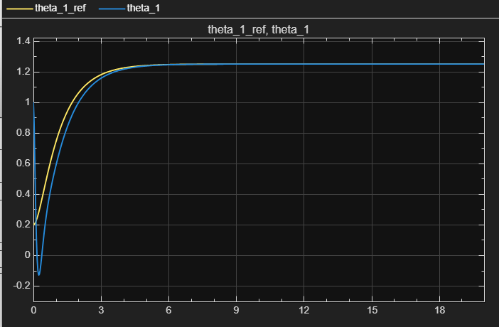
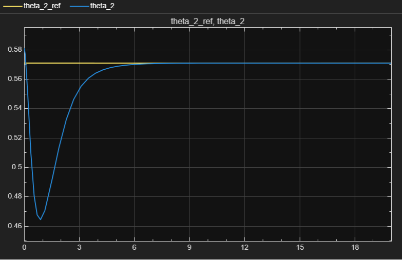
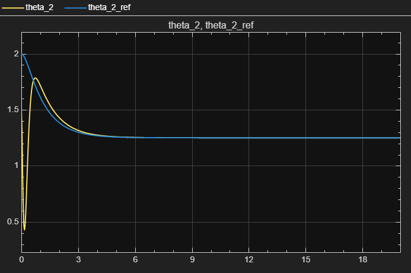
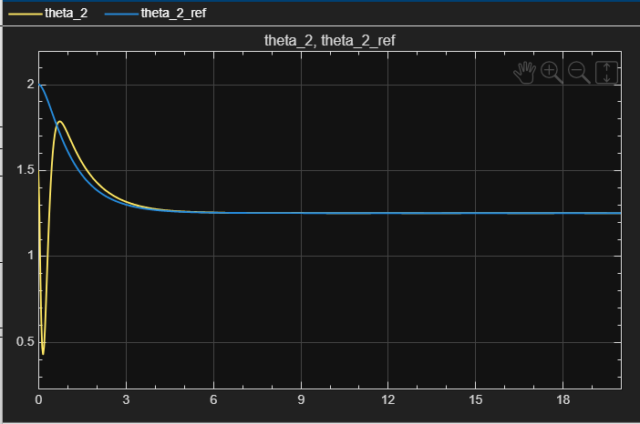
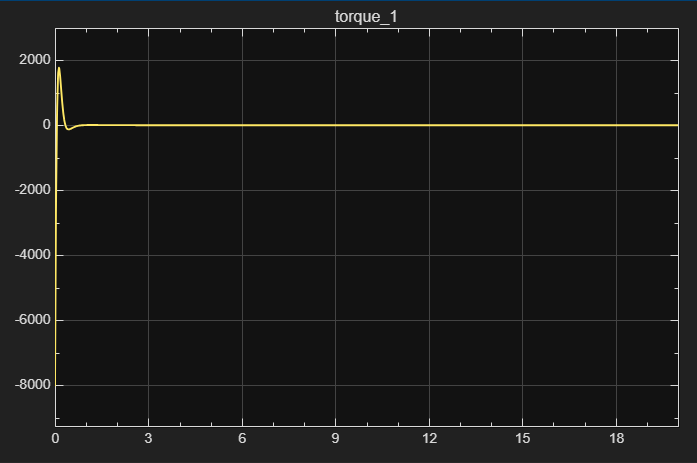
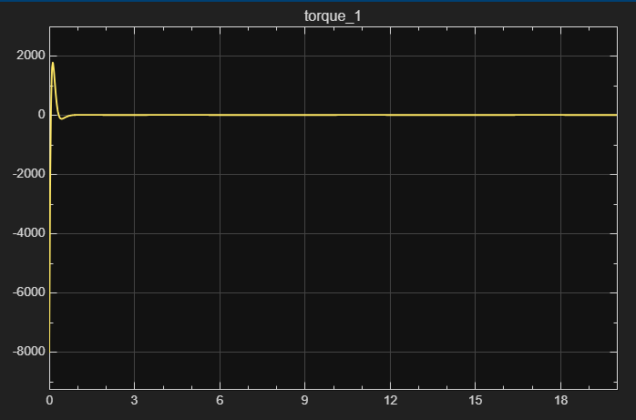
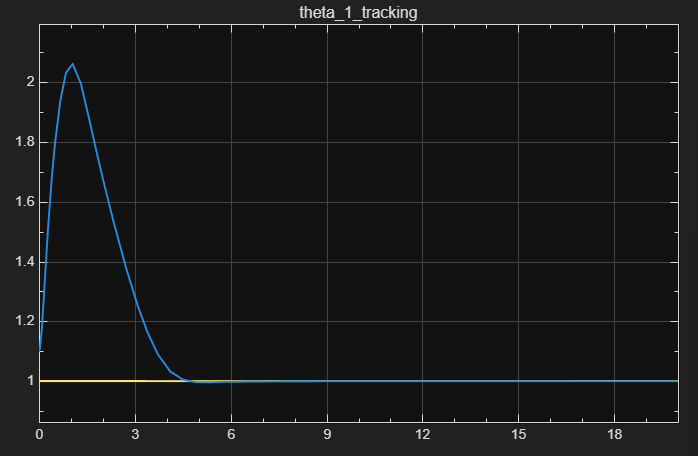
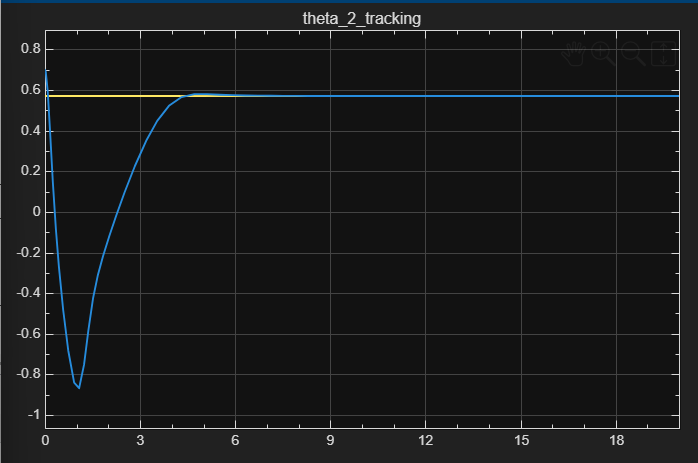

# Two-Link Manipulator Control: Feedback Linearisation & LQR (MATLAB/Simulink)

**Nonlinear control of a two-link robot arm in two set-ups: with both joints actuated, a feedback-linearisation controller tracks reference trajectories (steady-state error about ±0.005 rad); with the joint-2 motor removed, partial feedback linearisation + LQR stabilises the arm at an equilibrium where gravity balances the passive joint.**

| Fully actuated: joint 1 tracking | Underactuated: passive joint 2 returning to equilibrium |
|:---:|:---:|
|  |  |

MSc Robotics coursework, *Advanced Control and Dynamics* (UFME7F-15-M), Bristol Robotics Laboratory. Graded at distinction level (70/100). Full write-up: [report (PDF)](report/two_link_manipulator_control_report.pdf).

---

## Overview

| | Fully actuated | Underactuated |
|---|---|---|
| Actuators | Motors at both joints | Motor at joint 1 only |
| Goal | Track time-varying references | Hold a feasible equilibrium |
| Controller | Feedback linearisation + pole placement with integral action | Partial feedback linearisation + LQR |
| Key result | Tracks both references; steady-state error ±0.005 rad under the specified disturbances | Stable at q₁ = 1.0 rad, q₂ = π/2 − 1 rad; holding torque 10.59 N·m |
| Main limitation | Peak torques ≈ 2000 N·m (joint 1) and 1200 N·m (joint 2); no actuator saturation modelled | Small region of attraction (see results) |

**Robot parameters:** m₁ = 0.5 kg, m₂ = 1.5 kg, I₁ = I₂ = 5 kg·m², L₁ = 1.0 m, L₂ = 0.8 m, g = 9.8 m/s².

---

## Method

### 1. Dynamics (Euler–Lagrange)

$$M(q)\ddot{q} + C(q,\dot{q})\dot{q} + G(q) = \tau$$

with the full M, C and G terms derived in the report (Section 2) and implemented in [`manipulator_dynamics.m`](matlab/blocks/fully_actuated/manipulator_dynamics.m).

### 2. Fully actuated: feedback linearisation + pole placement

The relative degree is 2 per joint (L_g L_f h = M⁻¹ is invertible), so the system can be fully linearised with the computed-torque law

$$\tau = M(q)\,v + C(q,\dot{q})\dot{q} + G(q)$$

which turns each joint into a double integrator q̈ = v. The outer loop uses state feedback plus integral action, with closed-loop poles placed at {−10, −11, −12}:

$$(s+10)(s+11)(s+12) = s^3 + 33s^2 + 362s + 1320 \;\Rightarrow\; K_D = 33,\; K_P = 362,\; K_I = 1320$$

### 3. Underactuated: equilibrium, partial feedback linearisation, LQR

- **Equilibria:** with τ₂ = 0, holding still needs G₂ = m₂gL₂cos(q₁ + q₂) = 0, so **q₁ + q₂ = π/2**: link 2 must be horizontal. Chosen point: q₁ = 1.0 rad, q₂ = 0.5708 rad.
- **Partial feedback linearisation:** solve the joint-2 equation for q̈₁ and set q̈₂ = v, giving τ₁ = α(x)·v + β(x) ([`partial_feedback_linearisation.m`](matlab/blocks/underactuated/partial_feedback_linearisation.m)).
- **LQR:** linearise about the equilibrium (controllability rank 4), Q = diag(10, 100, 1, 10), R = 1. The heavier weight on q₂ penalises the joint that cannot be driven directly. Result: K = [268.45, 257.96, 206.65, 184.93] ([`lqr_gain_calculation.m`](matlab/lqr_gain_calculation.m)).

---

## Results

### Fully actuated

| Without disturbance | With disturbance τ_d1 = 2 sin t + 0.5 sin 200πt, τ_d2 = cos 2t + 0.5 sin 200πt |
|:---:|:---:|
|  |  |
|  |  |

- Both joints converge to their references within about 5 s, after a transient caused by the initial state not matching the reference (q₁(0) = 1.0 rad vs q_ref1(0) = 0.2 rad).
- Steady-state tracking error stays within ±0.005 rad with the disturbances applied.
- Steady-state torques: τ₁ ≈ −3.5 N·m, τ₂ ≈ −9.5 N·m (gravity compensation).
- Peak torques of about 2000 N·m and 1200 N·m come from the large link inertias and aggressive poles. A real actuator would saturate (see Limitations).

### Underactuated

| Start at equilibrium | Start with q₁(0) = 1.10 rad | Start with q₂(0) = 0.70 rad |
|:---:|:---:|:---:|
|  |  |  |

- The controller holds the equilibrium with τ₁ settling at 10.6 N·m (feedforward value 10.59 N·m) and τ₂ = 0.
- **Region of attraction (one joint perturbed at a time):** stable for q₁(0) ∈ [0.98, 1.12] rad with q₂(0) = 0.5708, and for q₂(0) ∈ [0.54, 0.70] rad with q₁(0) = 1.0. Beyond this range the linearisation no longer holds and the controller fails.
- Removing a motor changes the problem from *tracking any trajectory* to *stabilising only where gravity balances the passive joint*.

---

## Repository structure

```
two-link-manipulator-control/
├── README.md
├── report/
│   └── two_link_manipulator_control_report.pdf   # full derivations and analysis
├── simulink/
│   ├── fully_actuated_manipulator.slx            # feedback linearisation + pole placement
│   └── underactuated_manipulator.slx             # partial feedback linearisation + LQR
├── matlab/
│   ├── lqr_gain_calculation.m                    # linearisation + LQR gain (run this first)
│   └── blocks/                                   # readable copies of the Simulink MATLAB Function blocks
│       ├── fully_actuated/
│       └── underactuated/
└── figures/
    ├── fully_actuated/{no_disturbance, with_disturbance}/
    └── underactuated/{equilibrium_start, q1_start_1.10, q2_start_0.70}/
```

## How to run

**Requirements:** MATLAB R2025a (earlier recent releases may work), Simulink, Control System Toolbox, Symbolic Math Toolbox.

1. Run `matlab/lqr_gain_calculation.m` to see the linearised A, B matrices, the controllability check and the LQR gain K.
2. Open `simulink/fully_actuated_manipulator.slx` and press **Run**. Scopes show joint tracking, errors and torques.
   - To apply the external disturbance, remove the line `td = [0;0];` in the `manipulator_dynamics` block.
3. Open `simulink/underactuated_manipulator.slx` and press **Run**. Change the initial conditions on the q₁/q₂ integrators to explore the region of attraction.

## Limitations and future work

- **Actuator limits:** add torque saturation; the current peak torques are not physically realistic. Slower poles or reference shaping would reduce them.
- **Model uncertainty:** feedback linearisation assumes a perfect model. Next step: test robustness to ±10–20% errors in mass and inertia, as an industrial arm would see.
- **Underactuated range:** a linear controller only works close to the equilibrium. Nonlinear methods (energy-based swing-up, sliding mode) would widen the operating range.
- **Learning-based control:** replace or augment the model-based controller with a learned policy (RL or imitation learning) and compare against this baseline.
